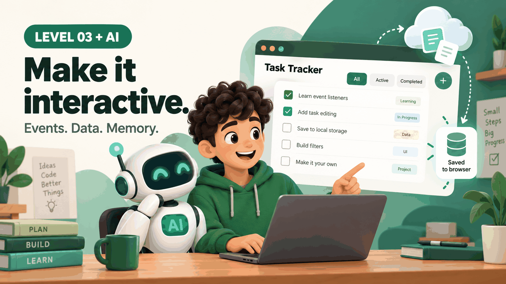

# Website development • Level 3 + AI

Make your page respond to people. Learn the DOM, events, data, and saving, and use AI to understand your own code.

Previous: [Level 1](https://github.com/yayacrypto/website-development-level-1) and [Level 2](https://github.com/yayacrypto/website-development-level-2).

## Who this is for

Learners who can build a responsive page (Level 2) and want to write real JavaScript. No framework, account, or paid AI subscription is needed.

## What you will build

A study tracker. You add tasks, mark them done, remove them, filter the list, and your tasks are still there after a reload. It also loads a random study tip from a local JSON file with `fetch`. There is no backend and no account. Data stays in your own browser.

## Start here

1. Download this repository and extract it.
2. Open `index.html` in a browser. The tracker works from a file.
3. To load the study tip, run a small local server in this folder, for example `python3 -m http.server 8000`, then open `http://localhost:8000`. Browsers block `fetch` for files opened straight from disk. The page shows a hint when that happens.

```text
website-development-level-3/
├── README.md
├── LICENSE
├── index.html
├── styles.css
├── app.js
├── data/
│   └── tips.json
└── assets/
    └── hero.png
```

## What is new in Level 3

### 1. The DOM: JavaScript's view of your page

The browser turns HTML into a tree of objects. JavaScript can find, create, and change them.

```javascript
const item = document.createElement("li");
item.textContent = "Read chapter 1";
document.querySelector("#task-list").append(item);
```

Use `textContent` for text people type. It treats everything as plain text. `innerHTML` would run typed markup and can open the door to attacks.

Try it: type `<b>hello</b>` as a task. It should appear as text, not bold.

### 2. Events

Code runs when something happens: a click, a key press, a form submit.

```javascript
form.addEventListener("submit", (event) => {
  event.preventDefault();
  // read the input, then update the page
});
```

Try it: add `console.log(event.type)` inside a handler and watch the browser console.

### 3. Data: arrays and objects

Each task is an object. The list is an array. Methods like `filter`, `map`, and `find` give you new views of the same data.

```javascript
const task = { id: 1, text: "Practice fetch", done: false };
const active = tasks.filter((task) => !task.done);
```

Keep one source of truth, the `tasks` array, and write a `render()` function that redraws the page from it. This pattern scales to bigger apps.

### 4. Saving data with localStorage

`localStorage` stores small strings in the browser, per site. Convert data with `JSON.stringify` and `JSON.parse`, and expect parsing to fail sometimes.

```javascript
localStorage.setItem("tasks", JSON.stringify(tasks));
const saved = JSON.parse(localStorage.getItem("tasks")) ?? [];
```

localStorage is not private or secure. Anyone using the browser can read it. Never store passwords or secrets there.

### 5. Fetching data

`fetch` asks for a file or an API and returns a promise. Use `async` and `await`, check `response.ok`, and handle failure.

```javascript
const response = await fetch("data/tips.json");
if (!response.ok) throw new Error("HTTP " + response.status);
const tips = await response.json();
```

## How to build with AI

### Step 1. Describe the behavior before the code

**Prompt to try**

> I want a to-do list in plain JavaScript with add, complete, remove, filter, and saving in localStorage. List the user actions and the data each one changes. Do not write code yet.

### Step 2. Build one feature at a time

**Prompt to try**

> Here is my render() function and the tasks array. Add a "Remove" button for each task. Change as little as possible and explain the new lines.

### Step 3. Make AI explain, then explain it back

**Prompt to try**

> Explain this code step by step. Then ask me three questions about it, one at a time, and wait for my answers.

### Step 4. Debug with the console

**Prompt to try**

> Expected: tasks remain after reload. Actual: the list is empty. Console error: [paste exact message]. Here are saveTasks(), loadTasks(), and the first lines of the file. What should I check first?

### Step 5. Test edge cases yourself

Empty input, very long text, text with `<` characters, many tasks, a cleared storage, a blocked `fetch`. AI often tests only the happy path.

**Prompt to try**

> List edge cases for this tracker that I should test by hand. For each, tell me what the correct behavior should be.

## Safety habits

- Treat all typed or fetched text as untrusted. Use `textContent`, not `innerHTML`.
- Do not store secrets in localStorage or in front-end code.
- Only `fetch` from sources you trust, and handle errors.
- Never paste private data into an AI prompt.

## Test checklist

- [ ] Add, complete, remove, and filter tasks.
- [ ] Reload and confirm tasks stay.
- [ ] Type `<b>x</b>` and confirm it shows as plain text.
- [ ] Try an empty task and a very long task.
- [ ] Use only the keyboard: Tab, Space, Enter.
- [ ] Open from a file and from a local server. Both should be understandable.
- [ ] Check the browser console for errors.

## Small challenges

1. Add a "Clear completed" button.
2. Let people edit a task by double-clicking it.
3. Add a due date and sort by it.
4. Show a count of active tasks in the page title.
5. Replace the local tips file with a public API and handle the failure case.

## Before publishing

Your tasks live in your browser only, so none of your data enters the repository. Still check the files for private notes before you publish.

## Ready for Level 4?

Move on when you can explain `render()`, add a feature without breaking the rest, and read an error message in the console. Next topics: Git, DevTools, debugging, and publishing a live site.

## References

- [MDN: DOM scripting introduction](https://developer.mozilla.org/en-US/docs/Learn_web_development/Core/Scripting/DOM_scripting)
- [MDN: Events](https://developer.mozilla.org/en-US/docs/Learn_web_development/Core/Scripting/Events)
- [MDN: Window.localStorage](https://developer.mozilla.org/en-US/docs/Web/API/Window/localStorage)
- [MDN: Fetching data](https://developer.mozilla.org/en-US/docs/Learn_web_development/Core/Scripting/Network_requests)
